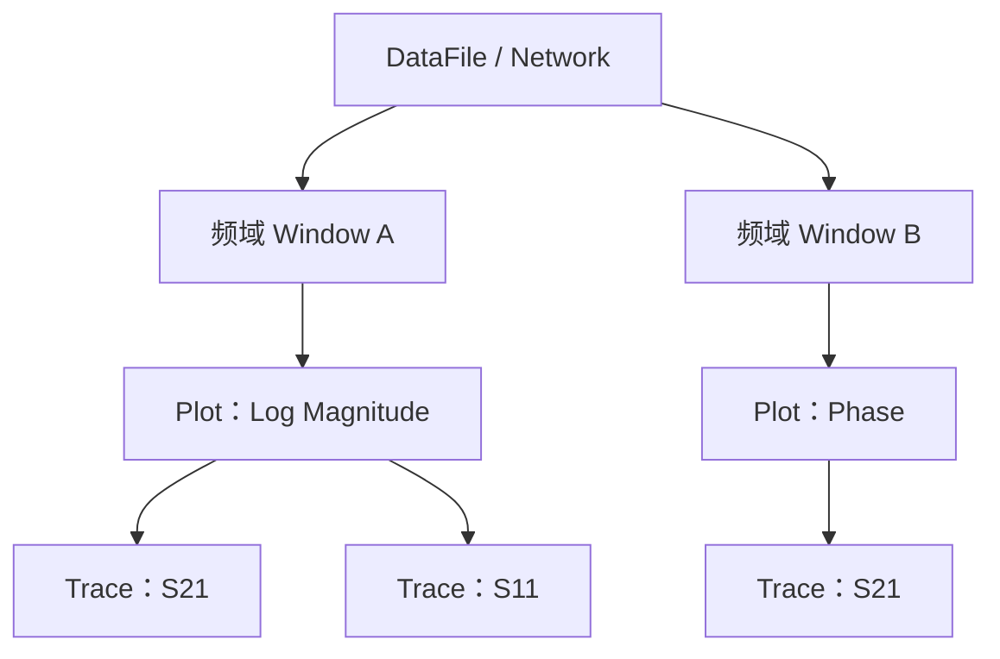

# ARCHITECTURE.md

# 1. Architecture Goals

Interconnect Studio 架构目标：

- GUI 与算法彻底解耦
- 数值算法可独立运行与验证
- 支持 AI Agent 分模块开发
- 支持 Golden Regression
- 支持未来仪器控制、Batch、插件化

# 2. High-Level Architecture

```text
PyQt6 UI
   ↓
Application / Services
   ↓
Core Domain ─ Algorithms ─ IO ─ Instruments
```

# 3. Repository Layout

下图是**目标结构**。标注 `<planned>` 的目录当前尚未创建，由对应 Roadmap Phase 落地时再新建。

```text
interconnect-studio/
├── AGENTS.md
├── pyproject.toml
├── src/interconnect_studio/
│   ├── app/
│   ├── ui/
│   │   ├── views/                         视图容器与网格编排
│   │   ├── widgets/
│   │   ├── panels/
│   │   ├── models/                        Qt model-view 适配
│   │   └── dialogs/
│   ├── core/
│   ├── algorithms/
│   │   ├── network/
│   │   ├── quality.py          （在 network/ 下，已实现）
│   │   ├── mixed_mode/
│   │   ├── time_domain/        <planned>  V1.0
│   │   ├── gating/             <planned>  V1.0
│   │   ├── crosstalk/          <planned>  V1.0
│   │   ├── si_metrics/         <planned>  V1.0
│   │   ├── rlcg/               <planned>  V1.1  传输线参数提取
│   │   ├── deembedding/        <planned>  V1.0
│   │   └── afr/                <planned>  V1.1
│   ├── io/
│   ├── compliance/             <planned>  V1.0  Limit Line / Mask / Pass-Fail
│   ├── report/                 <planned>  V1.1
│   ├── services/
│   └── instruments/            <planned>  待决策，是否实现未定
├── tests/
├── golden_data/
├── docs/
└── scripts/
```

## 3.1 一条记录在案的例外：`io` → `algorithms`

`io/touchstone2.py` 导入 `algorithms.mixed_mode.to_single_ended`。

Touchstone 2.0 的 `[Mixed-Mode Order]` 文件存的是混合模式矩阵，而下游的一切
（DUT Configuration、Balanced 视图、trace）都以单端 `Network` 为输入。读的时候
就换回单端，这个文件从此就是一份普通测量，没有任何地方需要判断「数据从哪来」。
换算本身是 `Mᵀ S_mm M`，属于算法，不应该在 `io` 里再抄一份。

§5 的禁止清单是明确的三条（`Algorithms → UI`、`Core → UI`、`IO → UI`），这条边
不在其中。记在这里是为了让它成为一个决定，而不是悄悄长出来的依赖。

# 4. Layer Responsibilities

## UI

负责 Widget、View、用户输入和显示状态。禁止实现核心算法。

外壳结构、视图网格、导航树层级与交互约定见 `docs/UI_DESIGN.md`。

## Services

负责 Use Case、Workflow、任务编排和 Project 状态协调。

## Core

负责稳定领域对象：Network、Trace、PortMap、Project、Fixture、Result。

## Algorithms

- Pure Python / NumPy
- 无 PyQt6 依赖
- 输入输出明确
- 可独立 benchmark / regression

## IO

Touchstone、Project 文件、Export、Config。

## Instruments

仪器连接与自动测量**当前不实现**，是否实现留待后续决策。校准（ECal / SOLT / TRL）同此——只有在自己控制仪器采数时才有意义，读已校准的 Touchstone 不需要。

若将来实现：接口按「测量源」而非「VNA」抽象，使 TDR 采样示波器等非 VNA 仪器能够接入；具体驱动不得侵入 UI。

# 5. Threading Model

```text
Qt Main Thread
     ↓ submit
Task Runner / Worker
     ↓ result/error/progress
Qt Main Thread
```

禁止 Worker 直接更新 Widget。

实现：`ui/task_runner.py` 的 `TaskRunner`（`QThreadPool` + `QRunnable`），全项目共用一个，
不为每个功能各起一条线程。

- 放在 `ui/` 而不是 `services/`：它是 Qt 管道，放进 `services/` 会让该包依赖 PyQt6，
  而 services 不依赖 GUI 正是它可测的前提。**被运行的是一个普通 callable**，
  真正的工作仍然留在 Core / Algorithms / IO，可以脱离 Qt 直接测。
- 结果与错误经 signal 回到提交它的线程；异常只把一行消息给用户，完整 traceback 进 `logging`。
- `TaskHandle.cancel()` **不能**中断已经进入 NumPy 的运算，它只是不再投递结果——
  这正是「用户关掉对话框」需要的语义，docstring 里写明了，不假装能中断。

判据不是「感觉慢」而是实测：无源性检查是逐频点 SVD，4 端口 1601 点 11 ms，
32 端口 16001 点约 4 s，64 端口 32001 点 35 s。后两者都是合法文件。

# 6. Typical Data Flow

```text
Touchstone File
  ↓
TouchstoneReader
  ↓
Network
  ↓
Service
  ↓
Algorithm
  ↓
AnalysisResult
  ↓
Plot Model
  ↓
UI
```

# 7. Dependency Rules

允许：

```text
ui → services
services → core / algorithms / io / instruments
algorithms → core
io → core
```

禁止：

```text
core → ui
algorithms → ui
io → ui
```

# 8. Planned Extensions

- Eye / PAM4 / COM、多通道仿真（V2.0）
- RLCG 提取与模型导出（V1.1）
- Delta-L（V1.0）
- Batch Processing
- CLI / Script API
- MCP Integration
- Plugin System

待决策（是否实现未定）：Calibration、VNA / TDR 仪器自动化、CSV / MATLAB 导出。

明确排除：COM 对象模型、功能分级授权。

# 9. Architecture Decision Records

建议：

```text
docs/adr/
0001-network-data-shape.md
0002-plot-library.md
0003-task-executor.md
0004-project-file-format.md
```

# 10. Open Decisions

- [x] 绘图库：pyqtgraph 用于交互视图，matplotlib 仅用于报告导出。第一版的 QPainter 自绘在对标 PLTS 后重新评估并推翻——矩阵视图、眼图、20k 点 30 fps 缩放所需的工作量不成比例
- [x] 纯 Python UI，不使用 Qt Designer `.ui`
- [x] Project 文件格式（`.icproj` v2，兼容读取 v1；JSON + NPY ZIP，含布局/曲线/数据；见 `FILE_WORKFLOW.md`）
- [ ] 是否采用 pydantic
- [ ] Plugin 机制


## First GUI Flow

> 本节记录早期单文件单图流程；当前已采用 `docs/UI_DESIGN.md` 的外壳与视图网格。其中的分层约束（MainWindow 不解析 Touchstone、Plot Widget 只消费 PlotModel）继续有效。

首个端到端 UI 流程：

```text
MainWindow
  ↓
File / Open Touchstone
  ↓
TouchstonePlotService
  ↓
read_touchstone()
  ↓
Network
  ↓
create_s_parameter_trace(S11/S21, LogMag)
  ↓
PlotModel
  ↓
CartesianPlotWidget
```

约束：

- MainWindow 不直接解析 Touchstone。
- UI 不直接执行 S 参数格式转换。
- Service 负责编排 IO 与算法。
- Plot Widget 只消费 PlotModel。

## 文件流程实现

`ui/file_workflow.py` 组合 MainWindow 的文件菜单、脏状态与最近文件；
`services/export_service.py` 编排范围截取、端口重排与明确的阻抗转换；
`io/network_writers.py` / `io/project_file.py` 负责写出/读取，`io/atomic.py` 负责原子替换。
工程对象位于 `core/project.py`，全局偏好使用 `ui/settings.py` 的 QSettings。
GUI 文件操作使用同一 TaskRunner，Worker 只处理预先收集的纯数据与服务调用。

## 频域交互

`core/marker.py` 与 `PlotModel.markers` 保存纯领域状态；
`services/frequency_analysis.py` 负责测量点吸附、搜索、Delta、曲线管理及 CSV。
`ui/frequency_workflow.py` 组合 MainWindow，管理停靠面板、曲线/Marker 和导出入口；
绘图 Widget 只发出拖动位置，通过服务生成新模型。数据表使用 QAbstractTableModel 虚拟读取。
Qt 图形渲染在 GUI 线程，CSV 和图片文件写入使用 TaskRunner。

TaskRunner 的内部完成信号先到 QObject 绑定的 GUI slot，再检查取消状态并投递公开结果。
因此工作已完成但结果仍在排队时，取消也会丢弃回调；销毁 runner 会断开排队的接收 slot。
TaskHandle 在投递结束前保留临时 runner，避免调用者仅传入临时对象时过早析构线程池。

## PLTS 分析工作台

`ui/analysis_workspace.py` 组合文件摘要、现有 Analysis View 网格、数据表和刻度入口。
不建立独立文件比较页面；比较 UI、专用展示服务及主动跨文件叠加操作已移除。
保留旧工程中多来源曲线的读取、来源清理和导出，未修改公共文件格式。

`ui/theme.py` 集中提供样式，错误提示通过 `errorText` 挂接。
`WindowSession.display_ranges` 是 UI 会话缓存，保存工程仍只写当前范围与停靠状态。
文件导入、格式化和写出继续使用现有服务和 TaskRunner。

# 11. PLTS 核心概念、规格与操作

本节将 PLTS 的 Window / Plot / Trace 语义作为分析工作台的架构参照。**参考规格不等于当前已实现功能**：§11.6 单独记录现状与差距。本次整理只补充架构契约，不变更领域类型、数值算法或 `.icproj` 格式。官方在线帮助核对日期：2026-10-12；版本限定见各条说明。

## 11.1 对象层级与职责

| 概念 | 语义与所有权 | 当前工程对应 |
| --- | --- | --- |
| Data File / DUT | 数据及测量上下文；同一文件可打开多个分析视图 | `core/hierarchy.py::DataFile`、`core/network.py::Network` |
| Window / Analysis View | 一个分析窗口；默认关联一个文件和一种分析类型，持有图集合及布局 | `core/hierarchy.py::ViewWindow`、`core/layout.py::ViewLayout`；`ui/window_session.py::WindowSession` 管理 UI 会话 |
| Plot | 一个图框，包含曲线、坐标轴、显示格式、刻度及图级交互 | `core/plot.py::PlotModel`；范围及自动缩放状态目前保存在 UI 会话中 |
| Trace | 一条参数曲线或派生计算曲线，具有来源、计算配方、名称与数据 | `core/trace.py::Trace`、`TraceRecipe` |
| Marker | 图上的测量位置及读数；与曲线、测量点和 Delta 引用有关 | `core/marker.py::Marker`、`PlotModel.markers`；当前绑定 `trace_index` |
| Template | 可复用的显示配置，不是测量数据本身 | `core/template.py`、模板服务；保存范围见 §11.5 |

层级是显示所有权，不应把曲线显示实例等同于原始数据。以下为同一文件的两个频域视图示例；时域视图作为后续扩展同样遵循此层级。



同一个 S21 可以产生幅度和相位两个显示实例。数据来源 ID、Window 编号、显示名称是不同标识；重命名不能改变来源绑定，不能用窗口编号或文件名代替 `DataFile.id`。

PLTS 的 Data Sharing 允许跨文件、跨分析类型叠加，这是默认窗口上下文的例外。本工程**不提供文件比较、A/B 比较页、主动跨文件叠加或 Multi-Data 模板**；仅兼容旧工程已有的多来源曲线读取、来源清理和导出。[R1][R7]

## 11.2 参考规格与数量边界

| 对象 | PLTS 参考规格 | 架构解释 |
| --- | --- | --- |
| Window | 文件及窗口总数无固定 PLTS 上限，受系统资源限制 | 不以单图、单文件显示限制可加载数据总数 |
| Plot | 每窗口最多 144 个 | 数量上限，不代表强制 12×12 布局；本工程 `ViewLayout` 已校验 144 上限 |
| Trace | 每图最多 36 条，旧版为 16 条 | 与端口数、图数量分别约束；本工程尚无 36 条上限校验 |
| Port | PLTS 2018 起支持最多 64 端口 | 属于数据能力规格，不等于 64 个图或 64 条曲线；不能据此宣称本工程完成全部 64 端口流程 |
| Plot Format | 一个图采用一种显示格式 | 图内曲线应使用同一格式；不同格式应分图 |
| 名称 | Plot 自定义名最多 22 字符；Trace 标签约显示前 25 字符 | 后者是显示截断，不是曲线名称存储上限 |
| 参数选择 | ALL 面向当前可见的 16 个参数，滚动可显示其余参数 | 16 是选择面板的可见批次，不是数据参数总量 |

以上窗口、图与曲线规格来自 [R1]；全局绘图偏好另见 [R9]。对于 N 端口单端频域矩阵，可选择的 S 参数有 N² 个，这是矩阵结构推导，不应与上述容量限制混淆。

## 11.3 Window、Plot、Trace 支持的操作

下表描述 PLTS 的操作语义，**不是本工程已完成的菜单清单**。当前覆盖范围见 §11.6。

| 层级 | 操作 | 语义 |
| --- | --- | --- |
| Window | 创建 / 激活 | 从分析类型建立视图，再添加参数；活动窗口决定当前文件与分析上下文 |
| Window | 最大化 / 平铺 / 层叠 / 最小化 | 编排多个分析窗口；不同于一个窗口内部的 Plot 网格 |
| Window | Close View / Close File | 前者关闭当前视图；后者关闭文件及显示该文件的全部视图 |
| Plot | New Plot / New Trace | 前者新建图；后者向活动图添加曲线，不能混用两种语义 |
| Plot | 参数批选 | ALL、RL / IL / NEXT / FEXT 等组；时域有 TDR / TDT；on One 放同一图，on Many 分图 |
| Plot | 删除 / All Clear | 删除活动图或清空窗口中的图；达图数上限后应先释放图 |
| Plot | 放大 / 恢复 / 重排 | 双击切换单图放大与全图；PLTS 2016 起提供拖动重排 |
| Plot | Copy to New Plot | 复制图及全部曲线，副本使用不同曲线颜色 |
| Plot | 重命名 / 注释 / 图例 | 图名与参数身份分离；注释可多条、多行、拖动及复制；图例可显示文件名或路径 |
| Trace | 添加 / 删除 / 重命名 | 名称只改变显示；PLTS 在图内多于一条曲线时才提供 Delete Trace |
| Trace | Refresh / Z-Order | 刷新曲线及调整绘制前后顺序；标签颜色与曲线对应，悬停可查看来源 |
| Trace | Memory Trace | 官方操作入口已列出；冻结、刷新与持久化语义需另行核对后再设计 |

基础操作见 [R1]，注释及图例见 [R4]。PLTS 通过全局偏好配置各曲线序号的颜色、线型和线宽，不能按任意单条曲线独立配置；全局样式与曲线的数据/计算身份应分离。[R9]

## 11.4 关键依赖概念与操作

### 活动上下文

必须区分活动 Window、活动 Plot、当前 Trace 与当前 Marker。切换窗口恢复各自的布局、选择及显示状态；参数/格式面板作用于活动图，曲线数据表读取当前图，Marker 栏反映当前 Marker。文件列表的活动提示、标题和菜单能力由当前分析上下文驱动。[R2]

服务接收明确对象与选择参数，禁止通过控件文字推断目标。删除曲线或文件时，要同步处理 Marker 引用与数据来源；后台结果回到 GUI 时仍须检查会话是否有效。

### Analysis Type、Parameter、Format 与 Scale

| 依赖概念 | 定义与操作语义 | 工程约束 |
| --- | --- | --- |
| Analysis Type | 分析域与端口模式组合，如 Frequency Domain Single-End / Balanced、Time Domain Single-End / Differential；另有 Eye、RLCG 分析 | 不把所有模式视为已实现；能力开关由分析类型决定 |
| Parameter | Sij 的第一个端口是响应端，第二个是激励端；混合模式还包含响应/激励的 D/C 模式 | 内部端口 0-based、UI 1-based；差分配对来自 DUT / PortMap，不从名称猜测 |
| Format | 参数如何显示，如 Log / Linear Magnitude、Phase / Unwrapped Phase、Group Delay、Real / Imaginary、Smith / Polar、SWR、阻抗 | Format 与参数身份分离；SWR 面向反射参数；同单位不足以证明同格式 |
| Scale | 横纵范围、参考电平及每格单位，或最小/最大值；Zoom / Pan / Reset | 改显示刻度不能改写原始 Network；内部 Hz、s 与界面单位转换显式进行 |
| Autoscale | 活动图纵向曲线约占显示高度 80%；Autoscale All 作用于当前窗口全部图 | 与通用图形库的双轴 autoRange 不完全相同，需明确对齐策略 |
| Copy / Paste Plot Format | 复制格式及刻度设置 | 不复制或替换测量数据 |

频域横轴范围受测量频率区间约束；Smith / Polar 无普通横轴刻度调整。具体格式、缩放可用性必须按分析类型核对，不能将某一旧版 Eye 限制推广到所有版本。[R3]

UI 的 Window 是窗口对象；Time Domain Windowing 是数值窗函数，两者不得共用语义或配置字段。

### Marker 与测量读数

PLTS Marker 作用于 Plot，可显示各 Trace 在该位置的读数；当前工程的单曲线绑定模型与其存在差距。

| 操作 | PLTS 参考语义 |
| --- | --- |
| 移动 / Set At | 拖动、滑块、方向键或指定位置，关联测量点 |
| Min / Max / Target | 搜索测量位置；Target 从当前位置向右寻找首次目标出现，末端回绕，越界目标不移动 |
| 3 dB Search | 传输参数的 3 dB 搜索，不能无条件用于全部参数 |
| Delta | 内置 #1 / #2 差值读数；更通用运算由 Marker Math 提供 |
| Coupling | 按组联动多个图，每图最多属于一个联动组 |
| 保存 / 调用 / 导出 | Marker 集合按相同分析域调用；可导出文本/CSV，读数有效位可配置为 1–10 |

搜索交点与测量点吸附规则要在服务层定义，不能把“全局 Y 值最近点”直接称为 PLTS Target Search。[R5]

### Equation / Math

原始参数曲线和计算结果曲线应有不同的可复现配方。Quick Math 对同图多条曲线进行加、减、乘、除并产生新曲线；方程适用性受相同分析类型约束。类似 `1:S11` 的文件编号引用可能跨会话歧义，必须解析并绑定稳定的数据来源，不能绑定显示窗口编号。标准模板中的方程应限于同一数据文件。[R6][R7]

## 11.5 数据、工程状态、模板与偏好的边界

| 状态类别 | 保存对象与边界 |
| --- | --- |
| 测量数据 | `Network`、数据文件身份及 DUT 配置；显示操作不改变原始 S 矩阵 |
| 工程 `.icproj` | 当前 v2、兼容读取 v1；保存数据、布局、曲线配方/来源、Marker、当前范围及停靠状态，具体协议见 `FILE_WORKFLOW.md` |
| Window 会话 | `WindowSession` 保存窗口显示与选择；`display_ranges` 是 UI 格式范围缓存，目前不写入工程 |
| 模板 | 可复用的图布局与参数/显示配方；本工程当前模板不保存 Marker，不等同于完整 PLTS 模板 |
| 全局偏好 | QSettings 中的主题、目录及界面偏好；不代替工程数据或窗口状态 |

PLTS `.dut` 包含校正测量及相关分析/测量上下文；`.cal` / `.tdr` 是校准或设置文件，不能当成测量数据；`.dsta` 是设置状态，覆盖范围不同于完整数据文件。这些格式仅作为职责参照，本工程不因此宣称支持导入/导出。[R8]

PLTS 模板可包含 Marker、Math、Scale、Plot Name、Limit / Eye Mask 等显示配置；更改模板不会自动更新已打开视图，需重新打开应用。模板配置、工程状态和数据集是三类对象，不能为了复用显示而隐式复制或比较数据。[R7]

## 11.6 当前实现与后续对齐清单

| 能力 | 当前状态 | 后续架构工作 |
| --- | --- | --- |
| 数据文件 / 分析视图层级 | 已有 `DataFile`、`ViewWindow` 与独立会话；主区切换显示活动会话 | 多窗口平铺/层叠尚未实现，不把 Plot 网格称为 MDI |
| 默认 s2p 频域显示 | Frequency Domain (Single-End) 默认 2×2：上排 S11、S12，下排 S21、S22 | 保持用户规定顺序；每格是 Plot，不是四个独立 Window |
| Plot 布局容量 | Core 校验最多 144 格；GUI 提供 1×1、1×2、2×1、2×2 | 扩展图集合管理、重排及更多布局入口 |
| New Plot | `MainWindow.new_plot()` 替换活动格子的图 | 对齐 PLTS 时改为新增图；明确插入位置、扩容和满额行为 |
| 曲线容量及删除 | 支持添加、管理曲线；未校验 36 条上限，允许删除最后一条留下空图 | 决定是否严格对齐容量及菜单可用性，再实现验证 |
| Format / 绘图类型 | Trace 配方保存格式；Plot 校验单位；Core 已有 Cartesian / Smith / Polar 类型，当前交互路径主要为 Cartesian | 显式保证同图同格式；补齐复杂平面绘图及格式能力，不能仅以单位相同判定 |
| 缩放 | 已有范围、缩放、当前图及当前窗口全部图自动范围入口 | 对齐纵向 80% Autoscale 与 Reset 语义，补充格式/刻度复制；已有 Autoscale All 入口仍需核对具体范围策略 |
| Marker | 已有新增、拖动、吸附、Delta、Min / Max / Target；绑定单条曲线 | 图级多曲线读数、Target 搜索规则、3 dB、Coupling、Math、集合存取待补齐 |
| 图级编辑 | 尚未完整覆盖复制图、注释、图例、名称限制及拖动重排 | 先明确对象所有权，再补服务命令、交互与状态保存 |
| Equation / Memory Trace | 未形成完整对标能力 | 定义计算配方、引用解析及更新策略；Memory Trace 先核实官方语义 |
| 模板 | 已有单来源布局/配方复用 | Marker 等完整配置覆盖需独立设计；不引入 Multi-Data 比较模板 |
| 文件比较 | 明确排除，专用界面与服务已移除 | 仅保持旧工程兼容，不增加主动比较入口 |

后续实现按 UI → Services → Core / Algorithms / IO 分层：Core 描述对象与约束，Services 执行新增图、曲线管理、搜索等命令，UI 管理活动对象及渲染。数值格式转换和搜索规则不能写进 Widget。新增持久化字段时另行更新 `DOMAIN_MODEL.md` 与项目协议，不以本节替代格式决策。

## 11.7 官方参考

- [R1：Working with Windows, Plots and Traces](https://helpfiles.keysight.com/csg/N1930xB/GettingStarted/Working_with_Windows_Plots_and_Traces.htm)
- [R2：The PLTS Screen](https://helpfiles.keysight.com/csg/N1930xB/GettingStarted/The_PLTS_Screen.htm)
- [R3：Data Format and Scale](https://helpfiles.keysight.com/csg/N1930xB/Analyzing/Data_Format_and_Scale.htm)
- [R4：Plot Annotation and Legends](https://helpfiles.keysight.com/csg/N1930xB/GettingStarted/Plot_Annotation_and_Legends.htm)
- [R5：Markers](https://helpfiles.keysight.com/csg/N1930xB/Analyzing/Markers.htm)
- [R6：Trace Math](https://helpfiles.keysight.com/csg/N1930xB/Analyzing/Math.htm)
- [R7：Templates](https://helpfiles.keysight.com/csg/N1930xB/Analyzing/Templates.htm)
- [R8：File Save and Open](https://helpfiles.keysight.com/csg/N1930xB/FilePrint/File_Save_and_Open.htm)
- [R9：User Preferences](https://helpfiles.keysight.com/csg/N1930xB/ToolsAndUtilities/User_Preferences.htm)
