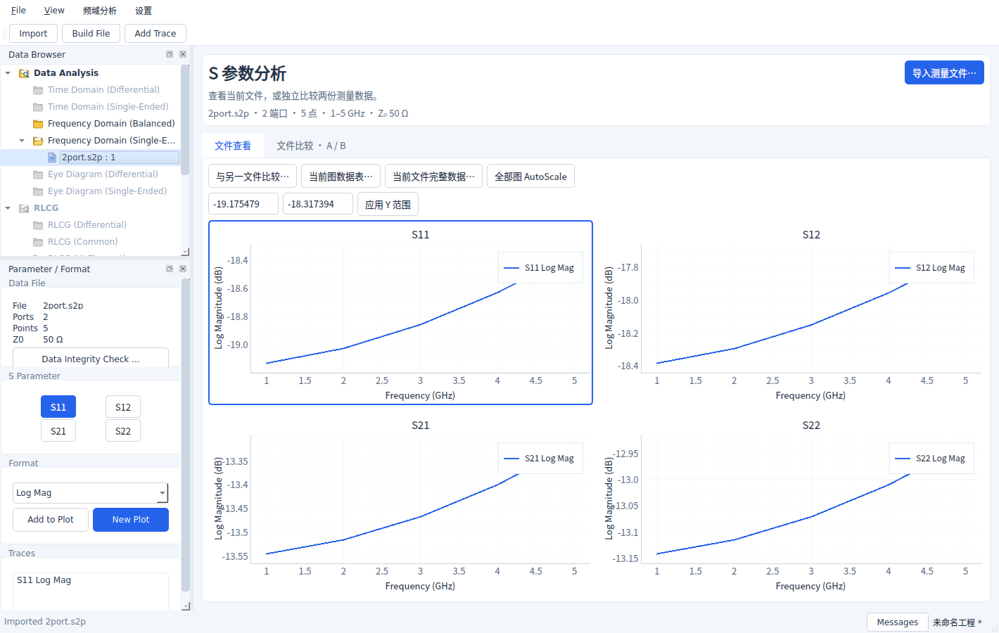
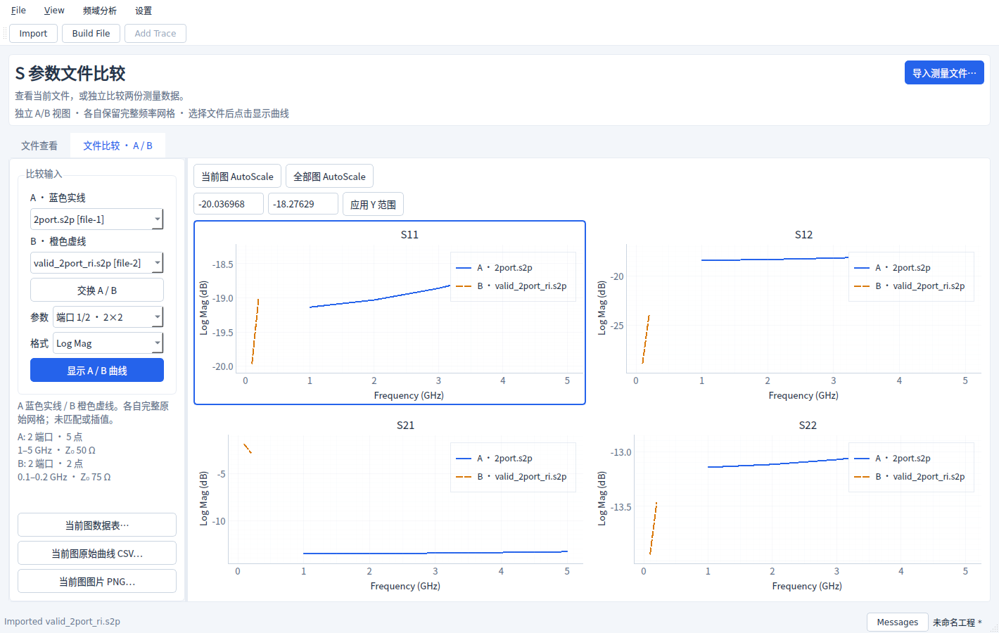

# 工程 GUI

本次按 `engineering-gui-style` 改造 Interconnect Studio，保留 PyQt6/pyqtgraph、
现有文件格式、工程/模板兼容、数值格式化、Marker、导入/导出服务与后台任务。

## 默认文件查看

- 无需创建工程即可导入 Touchstone/CITI，默认进入文件查看。
- 左侧数据树和参数/格式面板可调整、浮动或关闭；长表单可滚动。
- 顶部紧凑摘要显示当前文件、端口、点数、频段、参考阻抗。
- 二端口 Single-End 的四图继续采用此前确认的顺序：S11/S12、S21/S22。
  本项目此排列优先于 Skill 的通用示例，不改变矩阵索引。
- 单一来源的曲线统一蓝色实线、无采样点；标题区分参数，图例保留曲线名。
- 当前图可手动设 Y 最小/最大；拒绝非有限数及倒置范围。全部图 AutoScale
  在主区直接可用，当前图 AutoScale、数据表、CSV/PNG 和复制图片仍可从频域菜单操作。
- 显示范围按参数/格式保留于会话，切换文件窗口后也可恢复。工程保存当前范围，
  不保存其他显示格式的历史缓存。

## 独立文件比较

从“与另一文件比较…”将当前文件送入 A，再明确选择 B。也可直接进入比较页。
选择器显示文件实例 ID，完整来源路径可从 tooltip 查看；同名文件可区分，不允许自比较。

- A 蓝色实线、B 橙色虚线，可交换两侧。
- 二端口可看 2×2，任意端口数可从双方共有的参数中选单图。
- 支持 Log Mag、Linear Mag、Phase、Unwrapped Phase、Real、Imaginary，复用既有算法。
- 两侧各自保留完整原始频率网格；不自动匹配、插值、拟合或判定通过/失败。
  本次没有新增差异统计算法或验收门限。
- 改 A/B、参数或格式即清空旧曲线、禁用导出；点击显示曲线后重新生效。
- 查看第三份文件、追加/关闭无关文件不改变已有比较；删除 A/B 输入使比较失效。
- 比较与查看的范围独立；比较各参数/格式的范围也分别保留于会话。
- 数据表/CSV 导出当前比较图两侧的原始样本和来源，PNG 导出当前比较图。
  数据表和图片不冒充匹配点或差异结果。频域菜单根据当前页操作，避免导出隐藏的查看图。
- 比较计算与文件写入经过共享后台 TaskRunner，模态忙碌状态保护重复操作及关闭。

## 状态与兼容

独立比较是本次会话的临时分析，不混入查看图，不写入 `.icproj` 或模板。
原先工程中保存的跨文件曲线、Marker 和 `compare_from_window` 程序接口仍有效。
图形导出沿用原始数据；本次不改数学算法、Network、阻抗定义或公共文件版本。

比较页临时隐藏查看侧栏，切回查看时恢复。保存工程或退出时记录查看侧栏的实际偏好，
下次默认查看不会因为退出时停在比较页而失去侧栏。比较显示格式与分隔宽度使用现有
QSettings 命名空间，非法格式回退 Log Mag；A/B 实例选择仅在会话中保留。

## 运行检查

真实 Qt 控件已在 Linux 离屏环境检查：1420×900、1000×700 的文件查看、A/B 比较，
以及浅色/深色切换。小窗口侧栏通过滚动保留完整操作，分隔条禁止完全折叠比较区域。
截图使用项目自带测试测量，不代表实际器件。QA 环境加载 Noto Sans CJK SC 以检查中文、
负号、单位与下标；Windows 优先使用微软雅黑，Linux 建议安装 Noto Sans CJK SC。

自动检查包含原工程测试，以及 A/B 独立性、输入失效、同名/同实例、交换、不同频率网格、
范围恢复、菜单导出来源、保存时停靠状态、重命名和样式角色测试。
Windows 高 DPI 与真实仪器未在此环境验证。
