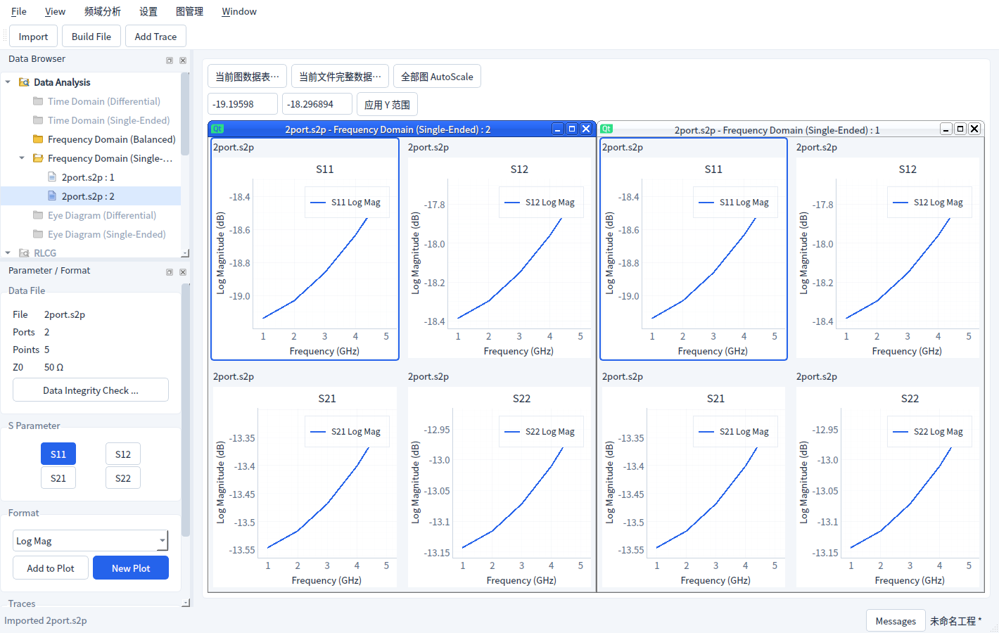
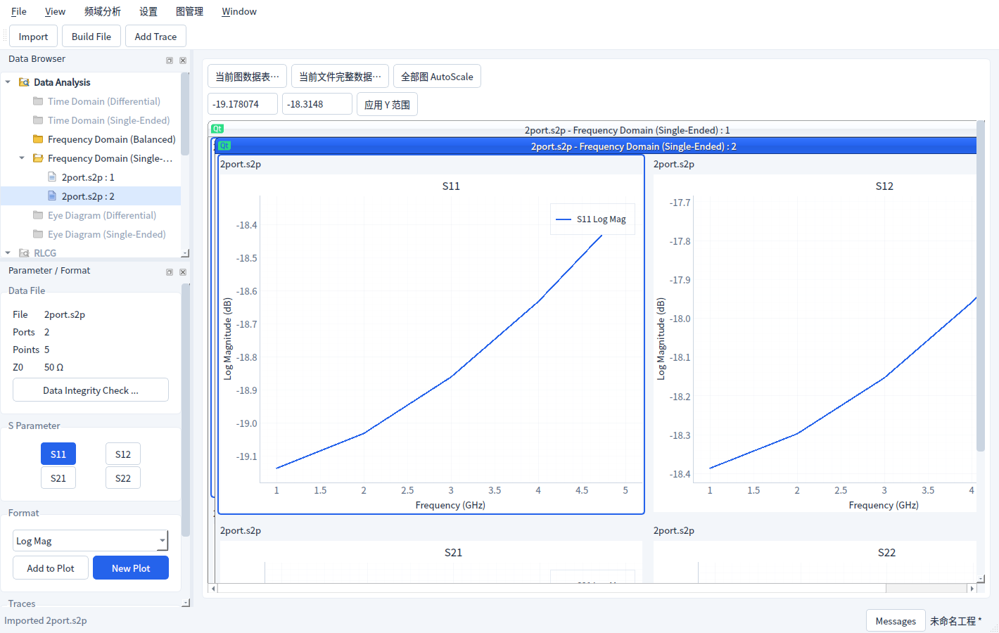

# Window 窗口管理

一个分析 Window 对应一个数据文件及一种分析类型。每个窗口持有独立的曲线、Plot 网格、
当前图、Marker 和坐标范围；Window 编排与窗口内部的 2×2 等 Plot 网格是两种操作。

## 打开与激活

- 导入文件自动打开分析窗口；点击 Data Browser 的分析类型可为当前文件新开空窗口。
- Window 菜单列出所有打开窗口，勾选项表示活动窗口。点击菜单条目或浏览器窗口节点激活
  窗口；最小化窗口会恢复。点击窗口内的图也会同步活动对象。
- Parameter / Format、频域 / Marker 面板、图管理、数据表及 Y 范围控件跟随活动窗口。
  各窗口保留自己的当前图，不因切换窗口重建绘图区。

## 编排与窗口控制

| 操作 | 行为 |
| --- | --- |
| Cascade（层叠） | 所有打开窗口以标题栏错位方式层叠 |
| Tile（平铺） | 所有打开窗口平铺显示 |
| 最大化 / 最小化 / 还原 | 作用于当前活动窗口，也可使用标题栏按钮或窗口系统菜单 |
| 关闭当前窗口 | 关闭视图、保留文件；快捷键 Ctrl+F4，等同于标题栏关闭或 Close View |
| 手动移动 / 缩放 | 拖动标题栏移动，拖动边框改变尺寸；不会调整原始测量数据 |
| 浮动 / 停靠 | Window 菜单或子窗口系统菜单浮动到桌面；浮动窗口顶部“停靠回工作区”返回 |

Cascade / Tile 会先收回全部浮动窗口、还原最小化或最大化状态，然后编排，保留原活动窗口。
桌面浮动窗口有原生最大化、最小化和关闭控件，可移动到其他显示器。
尺寸较小时建议最大化当前窗口查看详细曲线；工作区提供必要的滚动条。

## 文件与工程

Close View 不释放文件，关闭最后一个窗口后可重新打开分析视图、导出或保存文件。
Close File 会关闭该文件的全部窗口，包括浮动窗口；退出应用时统一处理未保存工程，取消
退出保留全部窗口。新建/替换工程后清理旧窗口并一次创建全部恢复窗口。

保存前读取所有实时窗口的 Plot 布局、曲线、Marker、刻度，包含非活动与浮动窗口。
`.icproj` v2 格式沿用原协议；窗口外框的位置、尺寸、浮动和最大化/最小化状态仅保留于当前
运行会话，打开工程时以普通 MDI 窗口显示，并按原规则激活第一个窗口/第一个 Plot。

## 验证环境

Linux Qt 离屏环境使用真实控件检查 1420×900 的平铺、层叠、浮动，以及 1000×700
的小尺寸和深色界面。测试覆盖菜单/原生激活、编辑目标、刻度与 Marker 独立性、原生
最小化不被激活回调撤销、浮动与停靠的控件归属/可见性、关闭与工程恢复、取消退出。
Windows 原生窗口装饰、跨显示器 DPI 和真实仪器未在本环境验证。

实现使用 Qt 的 [QMdiArea](https://doc.qt.io/qt-6/qmdiarea.html) /
[QMdiSubWindow](https://doc.qt.io/qt-6/qmdisubwindow.html) 与独立的浮动宿主，
复用既有分析服务及文件工作流。
